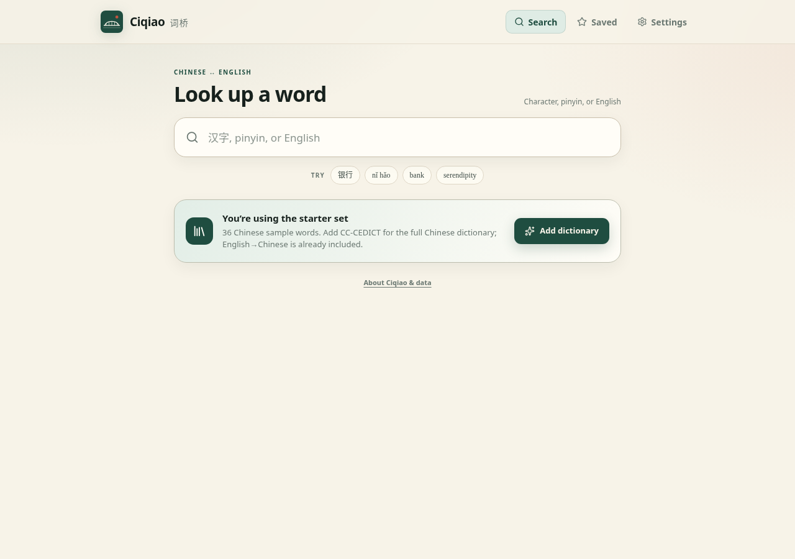
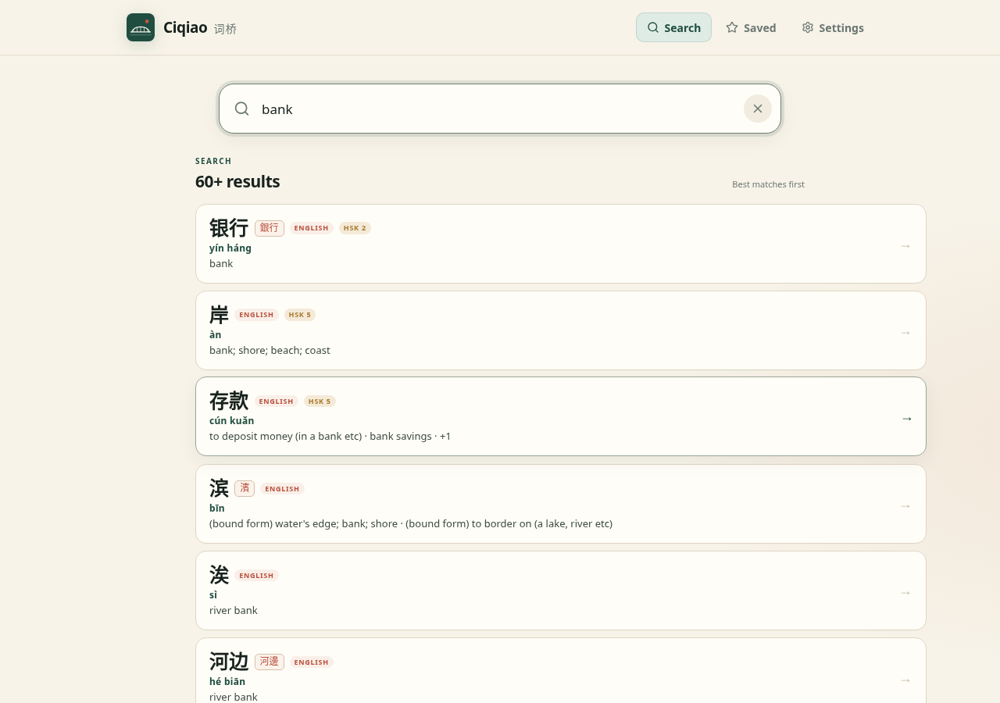
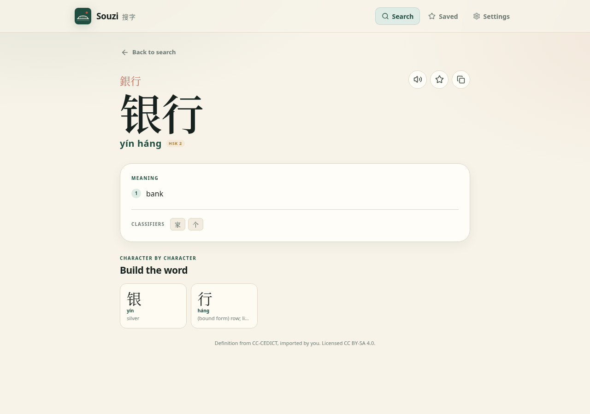
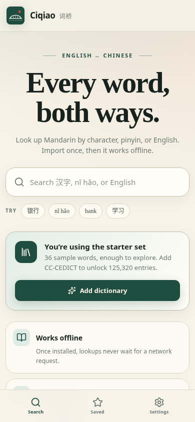
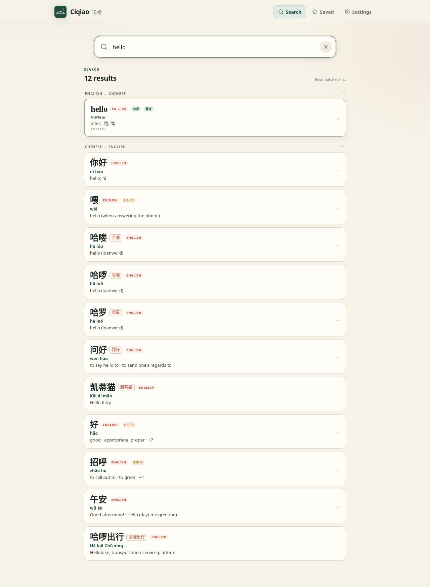
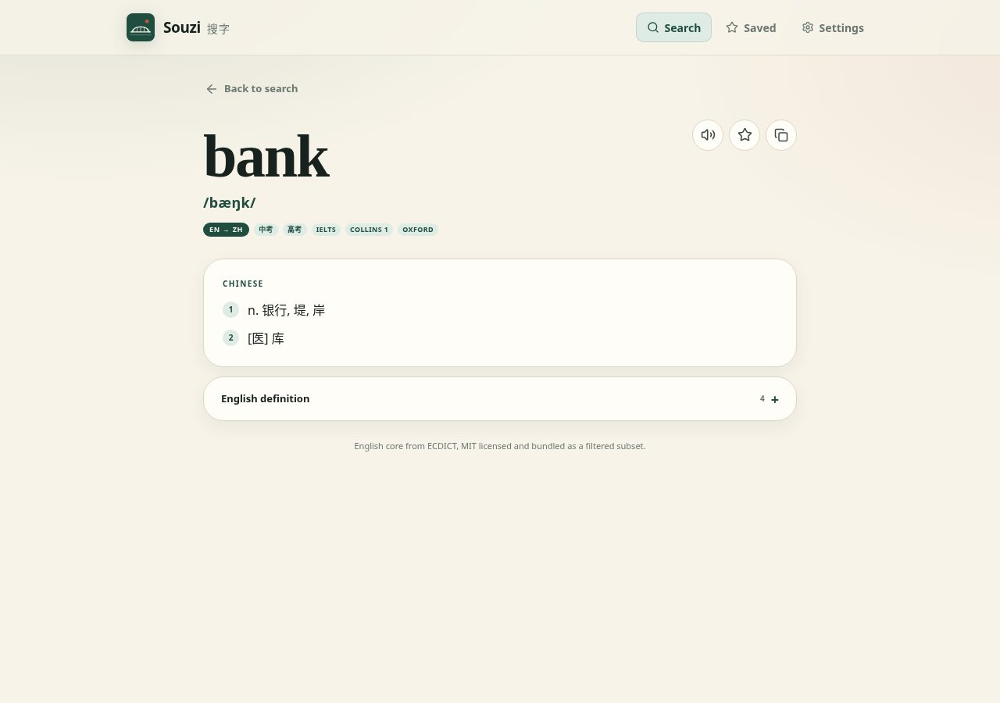
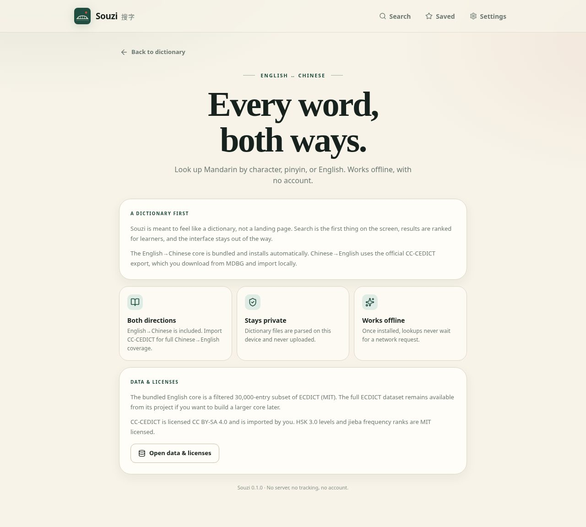

# Souzi 搜字

An offline-first English–Chinese dictionary for web/PWA and Android. It bundles a filtered ECDICT core for English→Chinese and imports CC-CEDICT locally for full Chinese→English coverage.

**Souzi does not redistribute CC-CEDICT.** You download the official export from MDBG and import it locally. The file is parsed in a Web Worker and stored in IndexedDB; it never leaves the device. The bundled ECDICT core is MIT licensed.

## Screens

| Home | Search |
| --- | --- |
|  |  |

| Entry | Mobile |
| --- | --- |
|  |  |

| English search | English entry |
| --- | --- |
|  |  |

<p align="center"></p>

## What works

- English→Chinese from a bundled 30,000-entry ECDICT core, including IPA, Chinese translations, exam tags, and English definitions.
- Chinese→English from a local CC-CEDICT import (`.txt.gz`, `.txt`, or `.zip`).
- Look up by simplified/traditional characters, pinyin (with or without tones), or English.
- Entry pages with pinyin, HSK level, classifiers, character breakdown, and text-to-speech.
- First-run setup: the bundled English→Chinese core installs automatically. The setup screen stays until the user chooses Continue or Skip, even across app restarts. Download runs inline in setup with progress and an editable Wi-Fi-only option; Continue opens the app while the download finishes. Settings has a dedicated Downloads page for progress, retry, pause, and cancel.
- Native CC-CEDICT download manager on Android with progress, pause/resume, retry, cancel, and a Wi-Fi-only option. Active downloads are monitored at app level so setup does not need to stay open; interrupted downloads can be retried.
- Large, high-contrast interface designed for comfortable reading. Typography uses distinct heading, body, and label roles; inputs and buttons use the label style. Layout and type use rem/em units and follow the browser or device text-size setting. Border widths, corner radii, and shadows intentionally use fixed px for crisp hairlines.
- Favorites and search history for both directions, stored locally.
- Installable PWA with an offline app shell.
- Dark/light/system theme.
- No server, no account, no tracking.

## Run it

```bash
pnpm install
pnpm dev
```

Open the local URL. The bundled English→Chinese core installs automatically. The first-run page offers the optional Chinese→English dictionary; you can start using the app without it.

To test the production PWA:

```bash
pnpm build
pnpm preview
```

## Android app (Capacitor)

An Android shell is in progress. Build requirements:

- Node 22+
- pnpm 10+
- JDK 21
- Android SDK platform 36 and build-tools 36.0.0

```bash
pnpm install
pnpm build
pnpm exec cap sync android
cd android
./gradlew assembleDebug
```

The debug APK is written to:

```text
android/app/build/outputs/apk/debug/app-debug.apk
```

`android/local.properties` should point at your Android SDK. The final package
ID is `com.amoshydra.souzi`. The GitHub Actions workflow
`.github/workflows/android-debug.yml` builds the debug APK on pushes and pull
requests.

On Android, the CC-CEDICT download is handled by the native app rather than a
file picker. It supports progress, pause/resume, retry, cancel, and a Wi-Fi-only
toggle. The web/PWA build keeps the manual download-and-import flow because it
does not have the native download bridge.

## Add the full Chinese dictionary

English→Chinese is already included. This import adds the full Chinese→English side.

On Android, open **Settings**, then **Downloads**, and tap **Download** under Chinese dictionary. The
app downloads the official export directly, supports pause/resume and a
Wi-Fi-only mode, and parses the file locally.

On the web/PWA, download the official CC-CEDICT export and import it manually:

1. Download the export:
   <https://www.mdbg.net/chinese/export/cedict/cedict_1_0_ts_utf-8_mdbg.txt.gz>
2. Open **Add dictionary** in the app.
3. Choose the downloaded `.txt.gz`.
4. Wait for parsing and indexing. The app then works offline.

The raw CC-CEDICT file is about 4 MB compressed. With both dictionaries installed, entries and indexes use roughly 40–60 MB in IndexedDB, depending on the browser. The bundled ECDICT core is about 2.8 MB compressed and installs automatically on first launch.

## Why import instead of bundling?

CC-CEDICT is licensed CC BY-SA 4.0. Distributing a modified copy or a derived database triggers share-alike obligations. Local import keeps Souzi free of that redistribution and keeps the data under the user's control.

ECDICT is MIT licensed, so a frequency-filtered core can be bundled directly. The app still shows attribution and links to both licenses.

The ECDICT core is generated with:

```bash
pnpm run data:ecdict -- /path/to/ecdict.csv
```

That script selects exam-tagged / Collins / Oxford words first, then the most frequent remaining words, up to 30,000 entries.

## Architecture

```
src/
  components/       UI views
  data/             HSK levels and word-frequency ranks
  lib/
    cedict.ts       CC-CEDICT line parser
    pinyin.ts       numeric pinyin -> tone marks, search normalization
    indexer.ts      simplified/traditional/pinyin/English/character indexes
    search.ts       Chinese query detection, ranking, prefix and lemma search
    english.ts      ECDICT index build and English query search
    english-core.ts lazy-load the bundled ECDICT core
    db.ts           IndexedDB schema and dictionary/user data helpers
    starter.ts      original sample entries
  workers/
    import.worker.ts  decompress, parse, index, and store CC-CEDICT
public/data/
  ecdict-core.json.gz  filtered ECDICT core (MIT)
scripts/
  build-ecdict-core.mjs  regenerate the bundled core
```

Search uses precomputed lookup maps:

- `simp` / `trad`: exact and prefix Chinese headword lookup.
- `pinyin`: toneless pinyin, with `ü` indexed as both `v` and `u`.
- `english`: tokens from Chinese entry glosses, with query-time lemma candidates (`studies` -> `study`, `running` -> `run`).
- `char`: every character in every headword, for "words containing this character".
- ECDICT `words` / `variants`: exact English headwords plus inflected forms from the ECDICT `exchange` field (`went` -> `go`, `paid` -> `pay`).

Entries and indexes live in IndexedDB. The ECDICT core is a static gzip asset installed automatically on first launch, stored in IndexedDB, and cached by the service worker for offline use.

## Tests

```bash
pnpm test
```

Covers pinyin conversion, CC-CEDICT parsing, Chinese and English index building, and search behavior against the starter set and a small ECDICT fixture.

## Data licenses

- **ECDICT**: MIT, [skywind3000/ECDICT](https://github.com/skywind3000/ECDICT). A filtered 30,000-entry core is bundled.
- **CC-CEDICT**: CC BY-SA 4.0, MDBG and contributors. Imported by the user; not bundled.
- **HSK 3.0 word list**: MIT, [ivankra/hsk30](https://github.com/ivankra/hsk30).
- **Word frequency ranks**: MIT, [jieba](https://github.com/fxsjy/jieba).
- **Starter set**: original sample entries written for Souzi.
- **App code**: Apache-2.0. See `LICENSE` and `THIRD_PARTY_LICENSES.md`.

## Deployment

Any static host works. Cloudflare Pages, Netlify, and GitHub Pages are fine. Use a stable origin so IndexedDB data survives deployments. If you deploy under a subpath (for example a GitHub Pages project site), set Vite's `base` and update the manifest `start_url`/`scope` and icon paths to match; the default config assumes the domain root.

Do not add a server-side proxy that downloads CC-CEDICT on behalf of users. That turns Souzi into a distributor. Keep the import local.

### GitHub repo setup (amoshydra/souzi)

1. **Pages**: Settings → Pages → Build and deployment → Source **Deploy from a branch**, branch `gh-pages`, folder `/ (root)`. The `deploy.yml` workflow pushes the web app there (`https://amoshydra.github.io/souzi/`) and preserves previously published dictionary packs in `ecdict/`.
2. **Actions**: Settings → Actions → General → Workflow permissions: **Read and write permissions** (needed to publish the `gh-pages` branch and create releases). `GITHUB_TOKEN` is the only token used — no other token secret is required for Pages or the dictionary pack.
3. **Release signing**: run `scripts/generate-android-signing.sh` once (it prompts you to choose the keystore password, or set `SOUZI_KEYSTORE_PASSWORD` first to skip the prompt), then add the four printed repository secrets (`KEYSTORE_BASE64`, `KEYSTORE_STORE_PASSWORD`, `KEYSTORE_KEY_ALIAS`, `KEYSTORE_KEY_PASSWORD`). Back up the generated keystore; losing it permanently blocks app updates.
4. **Releases**: push a tag `app-v0.1.1` to build the signed APK and attach it to a GitHub Release for Obtainium. Push `dict-v2` or run the `Dictionary pack` workflow to build/publish a new full ECDICT pack (`ecdict-full-v2.sqlite.gz` plus manifest) as both a Release asset and Pages data; never overwrite an already published version — always bump `vN`.
5. **Obtainium**: point it at `https://github.com/amoshydra/souzi` (release APK assets match `souzi-*`), or add the repo URL directly.

## Roadmap

- Full ECDICT import for power users, plus common phrasal verbs and idioms.
- Full English dictionary support in the PWA (currently Android native SQLite; the web build ships the 30k core).
- Example sentence pairs (Tatoeba).
- Stroke-order data.
- Handwriting and OCR.
- Flashcards / Anki export.
- Optional AI explanations grounded in the imported dictionary.
